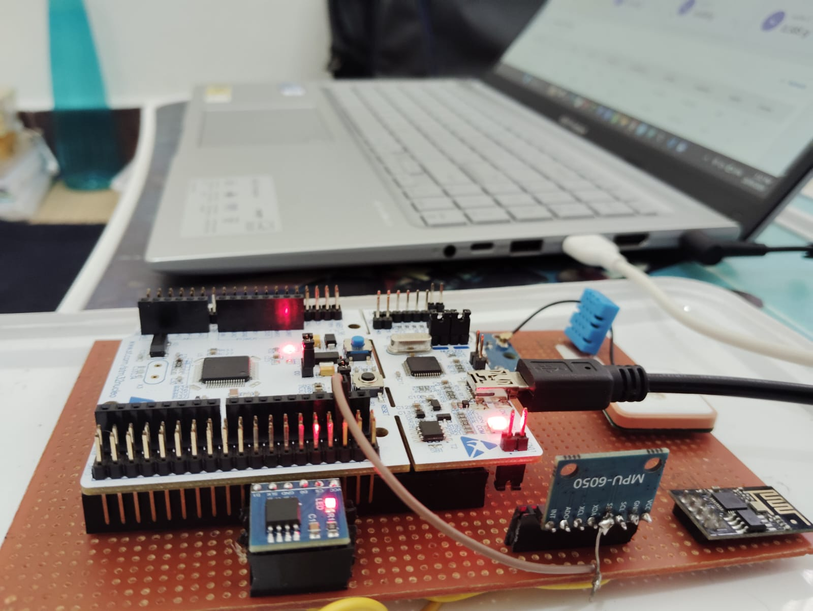
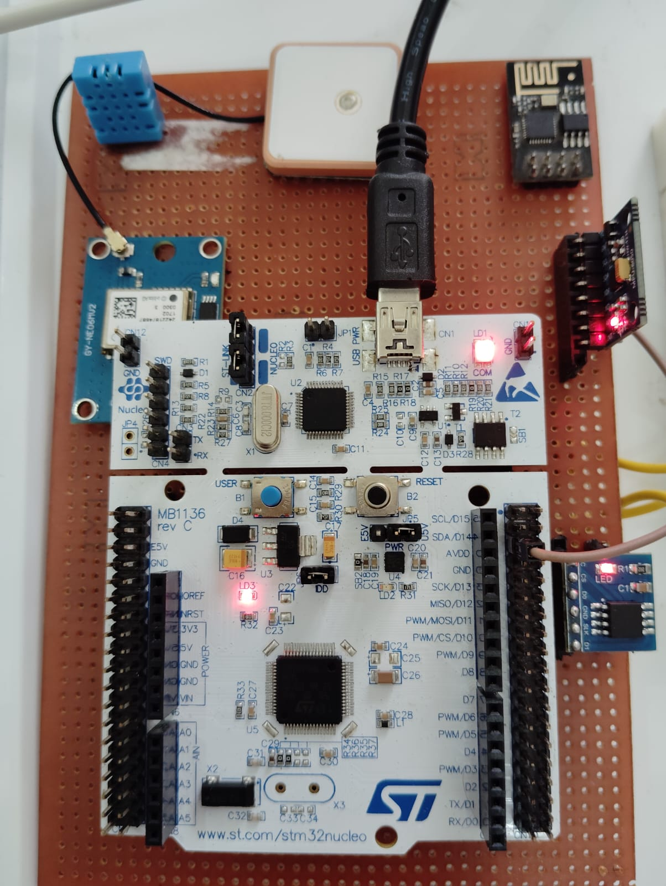
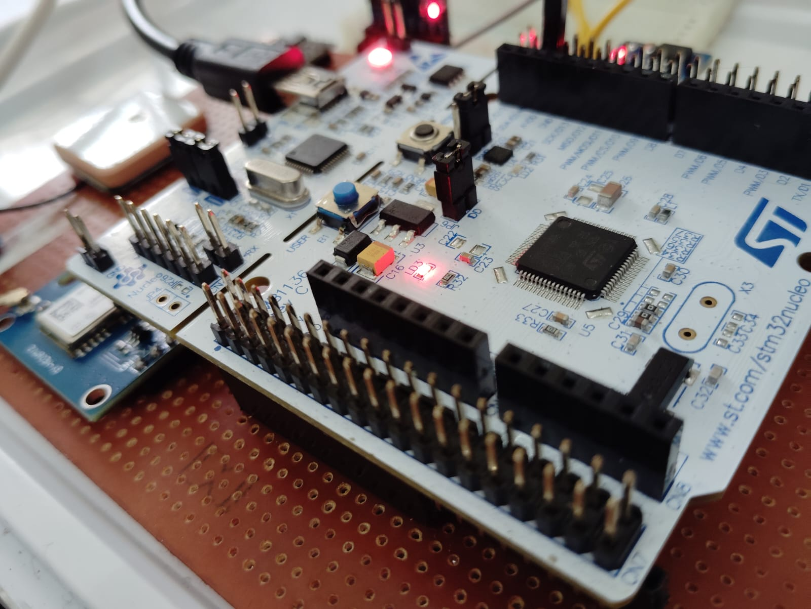
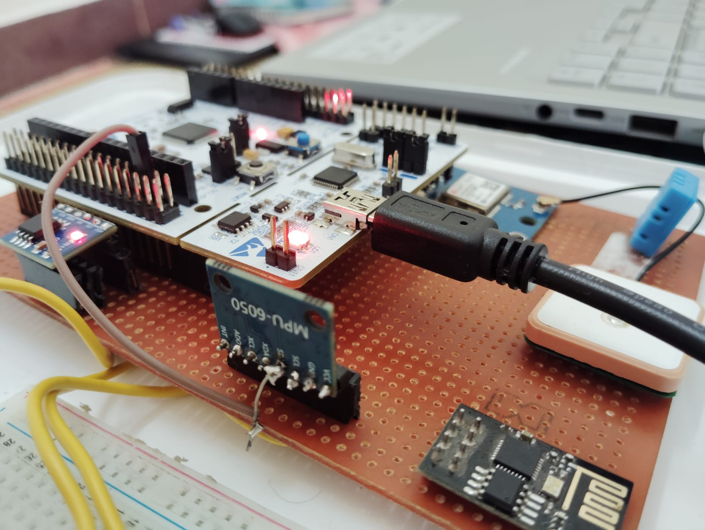

# IoT Asset Tracker

An STM32-based IoT asset tracking and monitoring system designed for logistics, transportation and asset-management applications.

The project integrates embedded firmware, GPS tracking, motion detection, environmental monitoring, local data logging, wireless communication, MQTT-based telemetry, backend processing and a web dashboard into an end-to-end IoT system.

---

## Overview

The system uses an **STM32F446RE microcontroller** as the main processing unit.

The STM32 collects data from multiple sensors and peripherals, processes motion events, generates structured JSON telemetry and stores telemetry locally in external SPI Flash memory.

The collected data is transmitted to an **ESP-01 (ESP8266) Wi-Fi module** through UART. The ESP-01 forwards the telemetry to an MQTT broker over Wi-Fi.

A Python Flask backend subscribes to the MQTT topic, processes incoming telemetry, stores the data in an SQLite database and provides REST APIs for the web dashboard.

## End-to-End Data Flow

  NEO-6M GPS ─────┐
  MPU6500 ────────┤
  DHT11 ──────────┤
  W25Q64 Flash ───┤
                  ↓
             STM32F446RE
                  │
          FreeRTOS Firmware
                  │
          JSON Telemetry
                  │
                UART
                  ↓
             ESP-01
             (ESP8266)
                  │
                Wi-Fi
                  ↓
          MQTT / Mosquitto
                  ↓
           Python Flask
              Backend
                  ↓
             SQLite DB
                  ↓
           REST API
                  ↓
           Web Dashboard


## Hardware Components

| Component | Function |
|---|---|
| STM32F446RE | Main microcontroller |
| NEO-6M GPS | Location, speed and course tracking |
| MPU6500 | Acceleration sensing and motion detection |
| DHT11 | Temperature and humidity monitoring |
| W25Q64 SPI Flash | Local telemetry storage |
| ESP-01 (ESP8266) | Wi-Fi connectivity and MQTT communication |

## Embedded Firmware

The STM32 firmware is developed in Embedded C using STM32 HAL and native FreeRTOS APIs.

### Peripheral Interfaces

- **UART:** GPS communication and ESP-01 communication.
- **I2C:** MPU6500 sensor communication.
- **SPI:** W25Q64 external flash memory.
- **GPIO/EXTI:** Sensor data interface and motion interrupt handling.

### Firmware Features

- GPS NMEA sentence reception and parsing.
- MPU6500 acceleration measurement.
- Interrupt-based motion detection.
- Heavy-motion event detection.
- DHT11 temperature and humidity measurement.
- W25Q64 local telemetry storage.
- UART-based communication with the ESP-01.
- JSON telemetry generation.

### FreeRTOS Implementation

The firmware uses two main FreeRTOS tasks:

| Task | Responsibility |
|---|---|
| `MotionTask` | Handles motion notifications, reads MPU6500 data and processes motion events. |
| `TelemetryTask` | Receives motion events, prepares JSON telemetry, stores data in flash and transmits it through UART. |

**RTOS synchronization mechanisms:**
- Binary semaphore for notifying the motion task from the interrupt.
- Queue for passing motion events between tasks.
- Task priorities to manage execution order.

## IoT Communication

The wireless communication architecture is:

```text
STM32F446RE
     │
     │ UART (JSON)
     ↓
ESP-01 (ESP8266)
     │
     │ Wi-Fi
     ↓
MQTT Broker (Mosquitto)
     │
     ↓
Flask Backend
```

**MQTT telemetry topic:**

```text
asset/ASSET001/telemetry
```

The ESP-01 receives JSON telemetry from the STM32 and publishes it to the MQTT broker.

## Backend and Web Dashboard

### Backend Technologies

- Python
- Flask
- MQTT
- SQLite
- REST API

### Frontend Technologies

- HTML
- CSS
- JavaScript

### Dashboard Features

The web dashboard displays:

- GPS location and position.
- GPS fix status.
- Temperature and humidity.
- Acceleration data.
- Motion events.
- Heavy-motion events.
- Historical telemetry records.

## Project Structure

```text
IOT-Asset-Tracker/
│
├── Core/
│   ├── Inc/
│   └── Src/
│
├── Drivers/
│
├── dashboard/
│   ├── backend/
│   └── frontend/
│
├── Tracker.ioc
├── .gitignore
└── README.md
```

## Technologies Used

**Embedded:**  
Embedded C, STM32F446RE, STM32 HAL, FreeRTOS

**Communication:**  
UART, I2C, SPI, Wi-Fi, MQTT

**IoT Backend:**  
Python, Flask, SQLite, Mosquitto

**Frontend:**  
HTML, CSS, JavaScript

## Project Photos

### Hardware Setup









### Project Demonstration

[Watch the hardware demonstration video](Media/video/Video.mp4)

---

## Project Objective

To develop an embedded IoT asset-monitoring solution that combines real-time sensor acquisition, motion-event detection, local data logging and wireless telemetry with a backend and web-based monitoring interface.